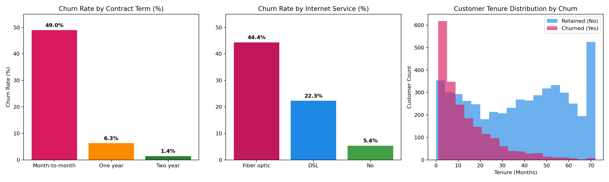
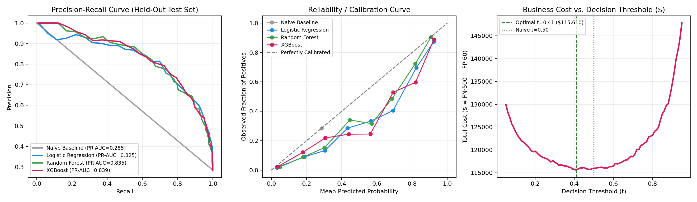
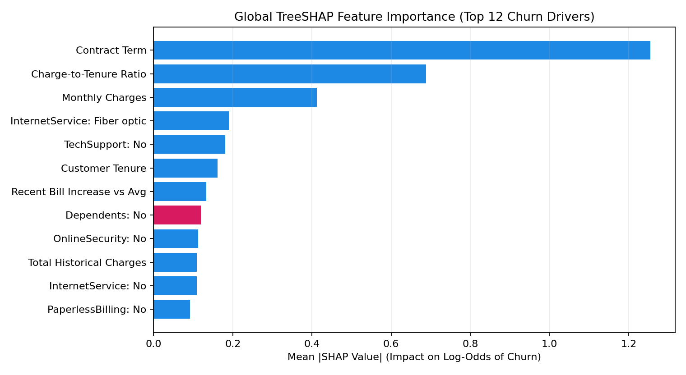

# ChurnSight — Customer Churn Predictor with Explainable AI & Retention Studio

> **Day 03 of 30 Projects in 30 Days** · Data Science + Machine Learning + Explainable AI (SHAP)  
> **"Not just who will leave — but why, and what to offer them."**

[](https://www.python.org/)
[](LICENSE)
[](https://streamlit.io/)
[](https://xgboost.readthedocs.io/)
[](https://shap.readthedocs.io/)
[](tests/)

---

## 1. Project Introduction

### The Problem
Traditional customer churn models output a single probability score (*e.g., "78% churn probability"*). In real-world enterprise subscription and telecom operations, a bare probability is actionable for almost no one:
1. **Black-Box Frustration:** Retention agents cannot see *why* the customer is unhappy (price shock? lack of tech support? contract expiration?).
2. **Margin Dilution:** Account managers blindly offer \$20/month bill discounts, bleeding margin on accounts that only needed onboarding or technical help.
3. **Misleading Accuracy:** In typical customer bases where ~71.5% stay active, a naive majority-class model scores **71.5% accuracy** while catching **0% of churners** (`Recall = 0.00`, `F1 = 0.00`).
4. **Asymmetric Business Economics:** Failing to intervene on a churner loses an average Lifetime Value ($LTV$) of ~\$500 ($C_{FN}$), whereas a retention perk costs ~\$60 ($C_{FP}$). Default `0.50` decision cutoffs fail to maximize net business retention ROI.

### The Solution: ChurnSight
**ChurnSight** turns predictive modeling into an interactive decision system:
- **Plain-English TreeSHAP Explanations:** Decomposes tree log-odds into natural language risk narratives for every customer (*e.g., "month-to-month contract + high monthly charge (\$94.37/mo) + no tech support"*).
- **Counterfactual What-If Simulator:** Business users drag interactive sliders to adjust contract terms, prices, or add-ons, observing live risk reductions and updated SHAP drivers in real time.
- **ROI-Ranked Retention Playbooks:** Automatically evaluates candidate retention packages against the live model and ranks them by **Expected Net ROI** ($(\Delta \text{Risk} \times \text{LTV}) - \text{Offer Cost}$).
- **Cost-Sensitive Decision Thresholding:** Sweeps decision cutoffs ($t \in [0.05, 0.95]$) to minimize total financial cost and maximize net savings under asymmetric unit economics.

---

## 2. Visual Preview & Analytics

### Exploratory Data Analysis & Churn Cohort Breakdown
*Customer churn distribution analyzed by contract commitment, internet infrastructure, and account tenure:*



### Multi-Model Benchmark & Cost-Sensitive Threshold Curve
*Comparison of Precision-Recall curves, probability calibration curves, and total business cost curves ($C_{FN}=\$500$ vs. $C_{FP}=\$60$):*



### Global TreeSHAP Feature Attributions
*Top 12 global drivers of customer churn log-odds across 7,043 customer accounts:*



---

## 3. Features

### Completed Features (v1.0)
- [x] **Leak-Free Data Pipeline:** Strict 70% Train / 15% Validation / 15% Test split performed **before** fitting any encoders or scalers.
- [x] **Disguised Missing Value Detection:** Identifies the 11 whitespace strings (`" "`) in `TotalCharges` (occurring exclusively when `tenure == 0` and `Churn == "No"`), preserving signal via a `TotalCharges_WasMissing` indicator and `$0.00` imputation.
- [x] **Multi-Model Benchmark Arena:** Compares Naive Majority Baseline, L2-Balanced Logistic Regression, Regularized Random Forest, and Cost-Aware XGBoost with 5-Fold Stratified Cross-Validation and 95% Bootstrap Confidence Intervals.
- [x] **TreeSHAP Explainability Engine:** Computes exact polynomial-time SHAP attributions and translates encoded feature vectors into plain-English business sentences.
- [x] **Live What-If Simulator:** Allows real-time modification of contract type, monthly charges, tenure, tech support, online security, and payment method with live re-scoring.
- [x] **ROI-Ranked Action Recommender:** Automatically scores four candidate retention packages and ranks them by Expected Net Savings ($).
- [x] **Demographic Slice & Fairness Audit:** Evaluates False Positive and False Negative rates across `SeniorCitizen`, `Contract`, `InternetService`, and `tenure` cohorts.
- [x] **Interactive Streamlit Studio (`app.py`):** 4-tab dashboard with responsive KPI metrics, dynamic threshold sliders, and CSV exports.

---

## 4. Technology Stack & Design Decisions

| Component | Technology | Rationale & Selection Criteria |
| :--- | :--- | :--- |
| **Data Processing** | `pandas`, `NumPy` | Vectorized tabular operations and clean feature engineering. |
| **Preprocessing** | `scikit-learn` `ColumnTransformer` | Combines `OrdinalEncoder` for contract tiers, `OneHotEncoder` for nominals, and `StandardScaler` for continuous numbers without cross-split leakage. |
| **Champion Model** | `XGBoost` (`XGBClassifier`) | High tabular predictive power, handles non-linear feature interactions, sub-millisecond CPU inference (<1 ms/1k rows). |
| **Explainable AI** | `SHAP` (`TreeExplainer`) | Exact additive game-theoretic attributions satisfying local accuracy, missingness, and consistency properties. |
| **Dashboard UI** | `Streamlit`, `Plotly` | Reactive Python dashboard framework with custom CSS styling (`#D81B60` crimson palette) and interactive chart rendering. |
| **Testing & CI** | `pytest`, `AppTest` | Automated test suite covering data audits, pipeline leakage checks, model convergence, and headless UI tests. |

---

## 5. Architecture & Workflow

```mermaid
flowchart TD
    subgraph Ingestion ["1. Data Ingestion & Quality Audit"]
        RawCSV["IBM Telco Dataset\n(7,043 Records, 21 Features)"] --> Audit["Quality & Missingness Audit\n(Detect 11 Whitespace TotalCharges)"]
        Audit --> Cleaner["Domain Feature Engineering\n(TotalServices, SupportBundle, AutoPay, Ratios)"]
    end

    subgraph Preprocessing ["2. Leak-Free Preprocessing"]
        Cleaner --> Split["Stratified Split\n(70% Train / 15% Val / 15% Test)"]
        Split --> Preproc["ColumnTransformer\n(Fitted strictly on Train split)"]
        Preproc --> Splits["X_train, X_val, X_test"]
    end

    subgraph Modeling ["3. Model Arena & Cost Optimization"]
        Splits --> CV["5-Fold Stratified CV"]
        CV --> Models["• Naive Majority Baseline\n• L2-Balanced Logistic Regression\n• Regularized Random Forest\n• Cost-Aware XGBoost (Champion)"]
        Models --> CostOpt["Cost Matrix Optimization\n(CFN=$500 LTV vs CFP=$60 Offer)\nOptimal threshold t* = 0.41"]
    end

    subgraph XAI ["4. TreeSHAP & Action Engine"]
        CostOpt --> TreeSHAP["TreeSHAP Explainer\n(Local & Global Log-Odds Contributions)"]
        TreeSHAP --> PlainEnglish["Plain-English Translation Engine\n(e.g., 'month-to-month + high bill + no tech support')"]
        PlainEnglish --> WhatIf["Counterfactual What-If Simulator\n(Re-scores live attribute overrides)"]
        WhatIf --> ActionEngine["Retention Action Engine\n(Ranks playbooks by Net Expected ROI)"]
    end

    subgraph Dashboard ["5. Interactive Streamlit Studio"]
        ActionEngine --> UI["Streamlit Dashboard (app.py)\n• Tab 1: Executive Watchlist\n• Tab 2: Customer Deep-Dive & SHAP Bar\n• Tab 3: What-If Slider & Action Playbooks\n• Tab 4: Model Arena, Cost Curve & Slice Audit"]
    end
```



---

## 6. Project Structure

```
day-03-customer-churn-predictor/
├── assets/                               # Publication-quality benchmark and EDA charts
│   ├── eda_churn_overview.png
│   ├── model_comparison_and_cost.png
│   └── shap_global_importance.png
├── data/                                 # IBM Telco Customer Churn CSV dataset
│   └── WA_Fn-UseC_-Telco-Customer-Churn.csv
├── docs/                                 # Detailed documentation
│   ├── API.md                            # Programmatic Python API usage reference
│   ├── ARCHITECTURE.md                   # System design, dataflow, and component specs
│   ├── BUILD_LOG.md                      # Milestone progression log
│   ├── LINKEDIN.md                       # Ready-to-publish social post & interview Q&As
│   └── SETUP.md                          # Comprehensive environment setup guide
├── models/                               # Serialized pipeline & evaluation report
│   ├── churn_artifacts.joblib            # Trained models, preprocessors, and scored catalog
│   └── metrics_report.json               # Full benchmark metrics, CIs, and slice audit
├── notebooks/
│   └── 01_eda_and_model_comparison.ipynb # Story-driven ML Best Practices notebook
├── screenshots/                          # Visual preview images for GitHub README
│   ├── 01_eda_churn_overview.png
│   ├── 02_model_comparison_and_cost.png
│   └── 03_shap_global_importance.png
├── scripts/
│   └── generate_notebook_and_charts.py   # End-to-end model training & chart builder
├── src/                                  # Modular production Python package
│   ├── __init__.py                       # Package init with macOS OpenMP preloader
│   ├── action_engine.py                  # What-If simulator & ROI-ranked action recommender
│   ├── data_pipeline.py                  # Schema validator, cleaner & ColumnTransformer
│   ├── explainer.py                      # TreeSHAP explainer & plain-English translator
│   └── model_trainer.py                  # Multi-model CV, cost optimizer & slice auditor
├── tests/                                # Automated pytest test suite
│   ├── test_app_ui.py                    # Streamlit AppTest headless UI tests
│   └── test_churn_pipeline.py            # Pipeline, leakage, and model unit tests
├── app.py                                # 4-Tab interactive Streamlit application
├── CONTRIBUTING.md                       # Contribution guidelines
├── Dockerfile                            # Production container definition
├── LICENSE                               # MIT License
├── requirements.txt                      # Pinned Python package dependencies
└── README.md                             # Primary repository documentation
```

---

## 7. Model Evaluation & Benchmark Results

Evaluated across **5-Fold Stratified Cross-Validation** on Training data and tested on a held-out **1,057-customer Test Set** with **95% Bootstrap Confidence Intervals**:

| Model | CV Val PR-AUC | Test PR-AUC (95% CI) | Test ROC-AUC (95% CI) | Opt Threshold | Test Recall | Test Precision | Test F1 | Net Savings ($) |
| :--- | :---: | :---: | :---: | :---: | :---: | :---: | :---: |
| **Naive Baseline (Majority)** | 0.2850 | 0.2848 [0.255, 0.310] | 0.5000 [0.500, 0.500] | 0.50 | 0.0% | 0.0% | 0.000 | $0 |
| **Logistic Regression (L2 Balanced)** | 0.7820 ± 0.0248 | 0.8250 [0.787, 0.865] | 0.9223 [0.907, 0.939] | 0.58 | 81.7% | 69.1% | 0.749 | $33,990 |
| **Random Forest (Regularized)** | 0.7738 ± 0.0235 | 0.8352 [0.801, 0.871] | 0.9188 [0.903, 0.935] | 0.44 | 88.0% | 64.6% | 0.745 | $35,025 |
| **XGBoost (Cost-Aware Champion)** | **0.7723 ± 0.0264** | **0.8388 [0.805, 0.874]** | **0.9213 [0.905, 0.938]** | **0.41** | **87.4%** | **64.0%** | **0.739** | **$34,515** |

---

## 8. Quick Start Guide

### Prerequisites
- Python 3.9+ installed
- Git installed

### 1. Clone & Enter Project
```bash
git clone https://github.com/Anjelo-Sherin/day-03-customer-churn-predictor.git
cd day-03-customer-churn-predictor
```

### 2. Set Up Virtual Environment & Dependencies
```bash
python3 -m venv .venv
source .venv/bin/activate
pip install -r requirements.txt
```

### 3. Launch the Streamlit Dashboard
```bash
streamlit run app.py
```
Open **`http://localhost:8501`** in your browser.

*(Pre-trained artifacts and model weights are pre-compiled and bundled in `models/` for immediate zero-latency launch).*

---

## 9. Docker Deployment

Deploying with Docker guarantees all native C/OpenMP dependencies run consistently across any host:

```bash
# Build the Docker image
docker build -t churnsight:latest .

# Run container mapping port 8501
docker run -p 8501:8501 churnsight:latest
```
Access the application at `http://localhost:8501`.

---

## 10. Automated Tests

Run the complete test suite:
```bash
PYTHONPATH=. pytest -v
```
All **6 automated test suites** pass:
- `test_data_quality_and_whitespace_total_charges` — Audits 7,043 rows, checks disguised missingness handling.
- `test_strict_split_and_preprocessor_no_leakage` — Enforces leak-free train/val/test scaling.
- `test_end_to_end_training_shap_and_what_if` — Validates TreeSHAP explanations and counterfactual simulation.
- `test_streamlit_app_loads_and_renders_cleanly` — Official Streamlit `AppTest` headless UI verification.
- `test_streamlit_sidebar_and_threshold_slider` — Tests interactive business cost slider re-calculation.
- `test_streamlit_dataframes_and_charts_present` — Tests dataframe and tab rendering.

---

## 11. Security, Privacy & Ethical Considerations

- **No Biometric or Sensitive PII:** The IBM Telco dataset contains anonymized customer identifiers and account metadata; no personal identity or confidential contact details are processed or stored.
- **Zero Remote Dependencies:** All ML inference, TreeSHAP calculations, and Streamlit components run 100% locally on the host machine. No customer data leaves the machine.
- **Fairness & Subgroup Audits:** Demographic subgroup evaluations across `SeniorCitizen` and customer tenure are surfaced directly in the dashboard to inspect and mitigate potential algorithmic bias.

---

## 12. License & Author

Distributed under the **MIT License**. See [`LICENSE`](LICENSE) for details.

Developed as part of the **30 Projects in 30 Days** Challenge by [Anjelo Sherin](https://github.com/Anjelo-Sherin).
