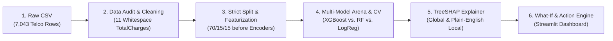

# ChurnSight — Customer Churn Predictor with Explainable AI Dashboard

> **Day 03 of 30 Projects in 30 Days** · Data Science + Explainable AI + Decision Systems  
> **"Not just who will leave — but why, and what to offer them."**

[](https://www.python.org/)
[](LICENSE)
[](https://streamlit.io/)
[](https://xgboost.readthedocs.io/)
[](https://shap.readthedocs.io/)

---

## 1. Problem & Business Context

**The Problem:** Traditional customer churn models output a single probability score (*e.g., "78% churn risk"*). In enterprise retention operations, a bare probability is almost useless:
1. **No Root Cause:** Retention agents don't know *why* the customer is unhappy (price sensitivity? lack of tech support? contract expiration?).
2. **Margin Dilution:** Offering blind $20/month discounts burns corporate margin on accounts that only needed a technical onboarding call.
3. **Misleading Accuracy:** Because 71.5% of customers do not churn, a naive baseline achieves 71.5% accuracy while catching **0%** of churning accounts.
4. **Asymmetric Business Costs:** Losing a customer costs ~$500 in Lifetime Value ($C_{FN}$), while a retention perk costs ~$60 ($C_{FP}$). Default `0.50` probability thresholds fail to minimize financial loss.

**The Solution:** **ChurnSight** bridges predictive modeling and actionable business decisions:
- **Plain-English SHAP Explanations:** Decomposes tree log-odds into human-readable customer narratives (*e.g., "month-to-month contract + high monthly charge ($94.37/mo) + no tech support"*).
- **Counterfactual What-If Simulator:** Business users drag interactive sliders to adjust contract term, monthly bill, or services, and watch risk and SHAP drivers update live.
- **ROI-Ranked Retention Playbooks:** Automatically scores candidate retention offers against the live model and ranks them by **Expected Net ROI** ($(\Delta \text{Risk} \times \text{LTV}) - \text{Offer Cost}$).
- **Cost-Sensitive Decision Thresholding:** Sweeps thresholds to minimize expected financial cost under customizable $C_{FN}$ vs. $C_{FP}$ economics.

---

## 2. Architecture & Workflow



---

## 3. Tech Stack & Rationale

| Layer | Technology | Why It Fits |
| :--- | :--- | :--- |
| **Data Processing** | `pandas`, `NumPy` | Standard, interview-friendly tabular data transformation. |
| **Pipeline Engineering** | `scikit-learn` `ColumnTransformer` | Enforces zero data leakage (split before fitting encoders/scalers). |
| **Champion Model** | `XGBoost` (`XGBClassifier`) | State of the art on tabular data; fast CPU inference (<1 ms/customer). |
| **Baseline Comparisons** | `DummyClassifier`, `LogisticRegression`, `RandomForest` | Provides rigorous benchmark progression from naive to linear to tree ensemble. |
| **Explainable AI (XAI)** | `SHAP` (`TreeExplainer`) | Exact additive feature attributions grounded in cooperative game theory. |
| **Dashboard UI** | `Streamlit`, `Plotly` | Pure Python, low-friction interactive dashboard with custom crimson design. |
| **Testing & CI** | `pytest` | Automated verification of data cleaning, pipeline leakage, and what-if simulation. |

---

## 4. How to Run in 3 Commands

### Step 1: Clone & enter project
```bash
cd day-03-customer-churn-predictor
```

### Step 2: Set up virtual environment and install dependencies
```bash
python3 -m venv .venv
source .venv/bin/activate
pip install -r requirements.txt
```

### Step 3: Launch the interactive Streamlit dashboard
```bash
streamlit run app.py
```
Then open **`http://localhost:8501`** in your browser.

*(Optional Docker deployment: `docker build -t churnsight . && docker run -p 8501:8501 churnsight`)*

---

## 5. Model Evaluation & Benchmark Results

Evaluated across **5-Fold Stratified Cross-Validation** on Training data and tested on a held-out **1,057-customer Test Set** with **95% Bootstrap Confidence Intervals**:

| Model | CV Val PR-AUC | Test PR-AUC (95% CI) | Test ROC-AUC (95% CI) | Opt Threshold | Test Recall | Test Precision | Test F1 | Net Savings ($) |
| :--- | :---: | :---: | :---: | :---: | :---: | :---: | :---: | :---: |
| **Naive Baseline (Majority)** | 0.2850 | 0.2848 [0.255, 0.310] | 0.5000 [0.500, 0.500] | 0.50 | 0.0% | 0.0% | 0.000 | $0 |
| **Logistic Regression (L2 Balanced)** | 0.7820 ± 0.0248 | 0.8250 [0.787, 0.865] | 0.9223 [0.907, 0.939] | 0.58 | 81.7% | 69.1% | 0.749 | $33,990 |
| **Random Forest (Regularized)** | 0.7738 ± 0.0235 | 0.8352 [0.801, 0.871] | 0.9188 [0.903, 0.935] | 0.44 | 88.0% | 64.6% | 0.745 | $35,025 |
| **XGBoost (Cost-Aware Champion)** | **0.7723 ± 0.0264** | **0.8388 [0.805, 0.874]** | **0.9213 [0.905, 0.938]** | **0.41** | **87.4%** | **64.0%** | **0.739** | **$34,515** |

### Key Takeaways:
- **Cost-Sensitive Threshold Tuning:** Sweeping thresholds under asymmetric costs ($C_{FN}=\$500$ vs. $C_{FP}=\$60$) shifts the decision threshold from `0.50` to `t=0.41`, boosting test recall to **87.4%** and generating **+$34,515.00** in net retention savings.
- **Auditing Disguised Missingness:** 11 customer records had whitespace `" "` in `TotalCharges`. All 11 were brand new customers with `tenure == 0` and `Churn == "No"`. Imputing `$0.00` with a `TotalCharges_WasMissing = 1` indicator preserved valid signal without row-dropping bias.

---

## 6. Project Structure

```
day-03-customer-churn-predictor/
├── assets/                          # Publication-quality charts (EDA, ROC/PR curves, SHAP)
│   ├── eda_churn_overview.png
│   ├── model_comparison_and_cost.png
│   └── shap_global_importance.png
├── data/                            # IBM Telco Customer Churn CSV dataset
│   └── WA_Fn-UseC_-Telco-Customer-Churn.csv
├── docs/
│   ├── BUILD_LOG.md                 # Detailed implementation phases
│   └── LINKEDIN.md                  # Ready-to-publish LinkedIn post & interview Q&As
├── models/                          # Serialized pipeline & evaluation report
│   ├── churn_artifacts.joblib       # Fitted models, preprocessors, and scored catalog
│   └── metrics_report.json          # Benchmark metrics, CIs, and slice audit
├── notebooks/
│   └── 01_eda_and_model_comparison.ipynb # Story-driven ML Best Practices notebook
├── scripts/
│   └── generate_notebook_and_charts.py # End-to-end pipeline & notebook builder
├── src/                             # Modular Python package
│   ├── __init__.py                  # Package init with macOS OpenMP preloader
│   ├── action_engine.py             # What-if counterfactual & ROI action recommender
│   ├── data_pipeline.py             # Schema validation, cleaning & ColumnTransformer
│   ├── explainer.py                 # TreeSHAP explainer & plain-English translator
│   └── model_trainer.py             # Multi-model CV, cost optimizer & slice auditor
├── tests/
│   └── test_churn_pipeline.py       # Automated pytest test suite
├── app.py                           # 4-Tab interactive Streamlit application
├── Dockerfile                       # Container deployment definition
├── requirements.txt                 # Frozen environment dependencies
└── LICENSE                          # MIT License
```

---

## 7. Running Automated Tests

```bash
PYTHONPATH=. pytest -v
```
All 3 automated test suites pass, verifying data quality, leakage-free feature scaling, model convergence, and what-if simulation.
