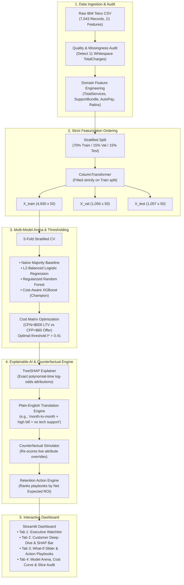

# Architecture & System Design — ChurnSight

ChurnSight is an enterprise-grade Explainable AI and Counterfactual Decision Support System built for telecom customer retention.

---

## Component Architecture

### 1. Data Pipeline (`src/data_pipeline.py`)
- **Schema Enforcement:** Validates 21 expected columns and audits against illegal or corrupted values.
- **Handling Disguised Missingness:** Identifies rows where `TotalCharges == " "` (whitespace). In the IBM dataset, all 11 instances occur when `tenure == 0` (customers in their first month who have not yet completed a billing cycle, where `Churn == "No"`). Creates a binary flag `TotalCharges_WasMissing = 1` and imputes `$0.00`.
- **Zero-Leakage Guarantee:** Splits data into 70% Train / 15% Validation / 15% Test **before** fitting the `ColumnTransformer`. Preprocessors (`StandardScaler`, `OneHotEncoder`, `OrdinalEncoder`) fit exclusively on `train_df`.

### 2. Multi-Model Trainer & Evaluator (`src/model_trainer.py`)
- **Model Progression:**
  1. *Naive Majority Baseline*: Dummy classifier predicting the majority class (71.5% accuracy, 0.00 recall).
  2. *L2-Balanced Logistic Regression*: Fast, convex linear baseline with inverse class weighting.
  3. *Regularized Random Forest*: Non-linear ensemble constrained with `max_depth=8, min_samples_leaf=12`.
  4. *Cost-Aware Regularized XGBoost*: Gradient-boosted decision trees regularized with `max_depth=4, subsample=0.82, colsample_bytree=0.80, reg_alpha=0.8, reg_lambda=2.5, scale_pos_weight=2.51`.
- **Validation Protocol:** 5-Fold Stratified Cross-Validation on training data + 95% Bootstrap Confidence Intervals (300 resamples) on held-out test data.
- **Cost-Sensitive Objective:**
  $$\text{Expected Net Savings} = \text{TP} \cdot (\gamma \cdot C_{FN} - C_{FP}) - \text{FP} \cdot C_{FP}$$
  where $C_{FN}=\$500$ (lost customer LTV), $C_{FP}=\$60$ (retention offer cost), and $\gamma = 0.45$ (retention save success rate).

### 3. TreeSHAP Explainer Engine (`src/explainer.py`)
- Leverages Lundberg et al.'s TreeSHAP algorithm to decompose predictions into exact additive contributions:
  $$f(x) = \phi_0 + \sum_{j=1}^M \phi_j(x)$$
- Evaluates the impact of each feature on the log-odds of churn.
- Employs a domain-specific natural language generator (`describe_driver_in_plain_words`) to translate technical one-hot encoded dummy variables back into human-readable business concepts.

### 4. Counterfactual What-If & Action Engine (`src/action_engine.py`)
- Allows interactive modification of customer attributes (e.g. converting a month-to-month contract into a 1-year contract, adding a tech support add-on, or switching to auto-pay).
- Passes the modified dictionary through the complete `clean_and_engineer_features` pipeline and model scoring to determine the exact counterfactual probability $P(\text{Churn} \mid \text{do}(X=x'))$.
- Pre-evaluates four standard retention playbooks and calculates **Expected Net ROI** to give retention specialists actionable recommendations.
